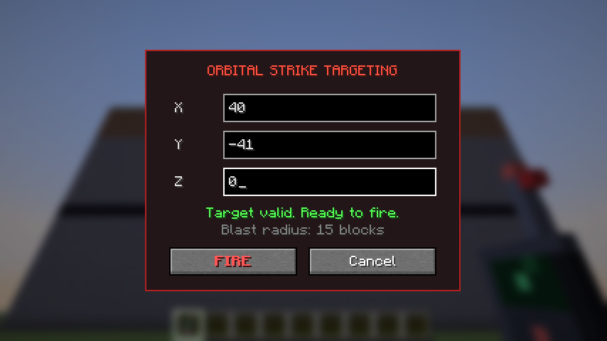
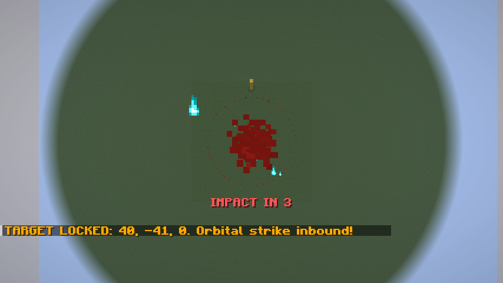
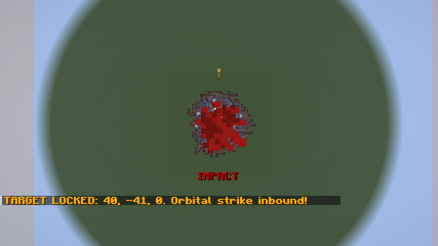
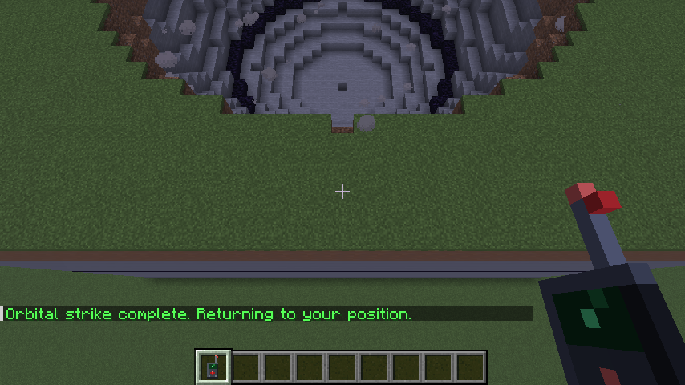

# Orbital Strike Cannon

A Fabric mod for Minecraft **26.3**. You enter coordinates at an **Orbital Terminal** or with a handheld **Targeting Remote**, then watch from above as a controlled TNT barrage hollows out a 30-block sphere.

| Targeting | Target lock (aerial view) | Annihilation | Aftermath |
|---|---|---|---|
|  |  |  |  |

*(These screenshots come from the automated client test described below.)*

## Gameplay

1. **Open the targeting screen.** Right-click an **Orbital Terminal** block, or use a **Targeting Remote**. The remote's rangefinder pre-fills the block you're looking at (up to 256 blocks away).
2. **Enter X / Y / Z.** The fields only accept integer characters. **FIRE** stays disabled until all three are valid integers and Y is within the world's build height. Enter also fires.
3. **The strike sequence runs:**
   - **Phase 1, target lock.** Your position, dimension, rotation, game mode and flight state are saved. You switch to spectator and are parked 60 blocks above the target, looking straight down. A particle beam descends from the sky, a red ring marks the blast radius, and a raid-horn siren sounds (audible up to 256 blocks).
   - **Phase 2, countdown.** 4 seconds of accelerating beeps, an "IMPACT IN n" HUD countdown and a charging sonic sound.
   - **Phase 3, annihilation.** Real primed TNT is armed and detonated in waves (see below). Then a quick sweep removes any stragglers.
   - **Phase 4, return.** After 3 seconds you're teleported back to your saved spot, and your game mode and flight state are restored.

### Recipes

```
Orbital Terminal          Targeting Remote
D S D                       E
T R T                     I R I
# # #                     I T I

D = diamond, S = nether star, T = TNT,      E = eye of ender, I = iron ingot,
R = redstone block, # = iron block          R = redstone, T = Orbital Terminal
```

## How the controlled detonation works

A radius-15 sphere contains about 14,000 blocks, so one TNT entity per block would kill the server. The mod uses `strike/DetonationPlan.java` instead:

- **Shells.** Charges sit on concentric shells at radii 14, 9 and 4, plus one at the centre. A Fibonacci (golden-angle) lattice spreads them evenly, with about 6 blocks between neighbours. That makes **105 charges** in total.
- **Inside-out waves.** The centre fires first, then each shell in turn, so every wave blasts into the cavity left by the previous one. At most **4 detonations (and 4 TNT spawns) per tick** happen, with 8-tick pauses between shells. The whole barrage takes **about 3.6 s**.
- **Sphere-shaped explosions.** `strike/SphereExplosionCalculator.java` plugs into the vanilla explosion ray-cast:
  - Inside the sphere, every breakable block has zero resistance. A charge therefore always clears at least 4.67 blocks in every direction, and no block is more than about 4.27 blocks from a charge.
  - Outside the sphere, everything (including air) has bedrock-level resistance, so blast rays stop dead at the sphere wall.
  - Bedrock and other unbreakable blocks are never destroyed.
- **Real TNT, controller-timed.** Each charge is a real `PrimedTnt` entity with its owner set to the player, so kills are credited to them. The controller detonates it on schedule through `level.explode(...)` with the calculator above, and the TNT entity is the explosion source.
- **Measured coverage.** A simulation of the vanilla ray algorithm in solid stone clears **100%** of the sphere with the TNT alone and touches **0** blocks outside it. The final budgeted sweep (8,192 positions per tick) is only a safety net, for example for blocks that fall into the crater during the barrage.
- **Debris.** Item drops inside the blast zone are vaporized, so hundreds of item entities don't pile up (`OrbitalStrike.VAPORIZE_DEBRIS`).
- **Chunk loading.** A chunk ticket keeps the blast zone loaded for the duration of the strike.

## Networking and security

- **S2C `orbitalcannon:open_targeting_screen`.** Only the server opens the screen, after a real block or item interaction. At that point it records a single-use *targeting session*.
- **C2S `orbitalcannon:fire_strike`** carries three integers. The server rejects it unless:
  - a session exists and is less than 5 minutes old (each screen can fire only once);
  - the uplink is still valid: you're still within reach of that terminal, or still holding a remote, in the same dimension, not a spectator;
  - the target is inside the world's build height and the world border;
  - you have no strike in progress, your 10 s cooldown has passed, and fewer than 3 strikes are running server-wide.
- **No stranded spectators.** Players who disconnect mid-strike are restored before their data is saved. A server shutdown restores everyone and removes any armed charges. If a strike throws an error, it is aborted and its player is restored.

## Building

Requires **JDK 25**.

```sh
./gradlew build            # -> build/libs/orbitalcannon-1.0.0.jar
./gradlew runClient        # dev client
```

## Automated client test

`src/gametest` holds a Fabric **client game test**. It boots the real client, creates a world and builds a stone plateau, then drives the mod with real input:

1. right-clicks the remote and waits for the server-opened screen;
2. checks that letters are filtered out and that FIRE stays disabled for a malformed integer;
3. types valid coordinates and clicks FIRE;
4. asserts each phase: spectator mode, 60 blocks up, camera looking down, nothing destroyed during the countdown;
5. checks the aftermath:
   - every block inside the radius-15 sphere is gone;
   - a control tower 18 blocks away and the plateau below the sphere survive;
   - no TNT or item entities are left over;
   - the player is back at their original position and game mode.

It saves screenshots to `build/run/clientGameTest/screenshots`.

```sh
./gradlew runClientGameTest
```

To run headless (CI or containers), use Xvfb with Mesa's lavapipe Vulkan driver. Minecraft 26.3's OpenGL backend needs an sRGB-capable visual, which Xvfb doesn't provide, but the Vulkan backend works:

```sh
sudo apt-get install xvfb mesa-vulkan-drivers
VK_ICD_FILENAMES=/usr/share/vulkan/icd.d/lvp_icd.json \
  xvfb-run -a -s "-screen 0 1280x800x24" ./gradlew runClientGameTest
```

## Project layout

```
src/main/java/com/orbitalcannon/
  OrbitalCannon.java                  mod entrypoint
  registry/ModBlocks.java, ModItems.java
  block/OrbitalTerminalBlock.java     right-click -> server opens targeting screen
  item/TargetingRemoteItem.java       use -> server opens targeting screen
  network/                            payloads + server-side validation
  strike/OrbitalStrikeManager.java    ticking, cooldowns, disconnect/shutdown safety
  strike/OrbitalStrike.java           the 4-phase state machine and effects
  strike/DetonationPlan.java          shell/lattice charge layout and schedule
  strike/SphereExplosionCalculator.java
  strike/SavedPlayerState.java
src/client/java/com/orbitalcannon/client/
  OrbitalCannonClient.java            S2C receiver
  screen/TargetingScreen.java         X/Y/Z input, validation, FIRE (C2S)
src/gametest/                         end-to-end client game test
```
